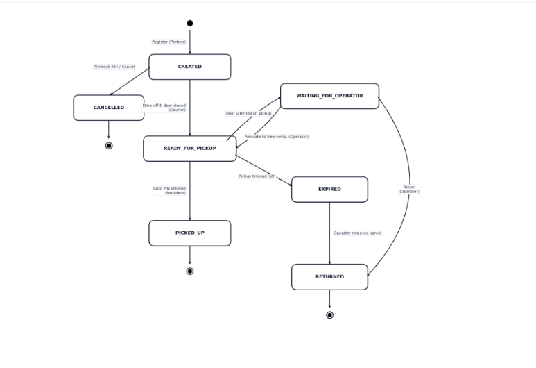

# HW1: Mid-term assignment report
Filipe Nogueira [119495], v2026-10-30

---

## 1 Introduction

### 1.1 Overview of the work

This report presents the midterm individual project required for TQS, covering both the software product features and the adopted quality assurance strategy.

The developed platform, TuttiBox, is a full-stack smart parcel locker management application built with Spring Boot 3.4.2 and PostgreSQL 16 that orchestrates the complete lifecycle of parcels across smart locker stations in Aveiro (sizes S, M, and L). It provides a RESTful API for e-commerce partners to allocate compartments, a web portal for recipients and operators to locate stations, track deliveries, and supervise operations, and a web-based locker terminal simulator for courier drop-offs and recipient pickups. External dependencies—namely locker hardware actuators, geolocation services, and recipient notifications—are decoupled through domain ports to enable deterministic unit, integration, BDD acceptance, and end-to-end testing.

### 1.2 My current implementation (limitations & extras)

* **Current Implementation Status**: All core functional use cases (UC1 to UC6) and domain business rules (BR1 to BR7) are covered by dedicated test suites spanning unit, slice, integration, BDD, and E2E layers, achieving a 100% pass rate across all 70 automated test executions in the Maven build lifecycle.
* **Limitations & Execution Constraints**: In containerized environments (such as GitHub Actions CI), integration suites execute against official PostgreSQL 16 containers via Testcontainers; in bare-metal host environments without a running Docker daemon, the suite gracefully falls back without breaking build execution. Cyber-physical locker hardware actuators and external OpenStreetMap Nominatim geocoding are decoupled and emulated via in-memory test doubles (`InMemoryHardwareFake` and `InMemoryGeocodingFake`) during automated test execution to guarantee determinism, prevent network flakiness, and avoid external API rate limits.
* **Extras Implemented**: An interactive cyber-physical locker terminal simulator with solenoid status badges, simulated door closure events, WCAG 2.1 high-contrast keyboard navigation, and a 60-second anti-brute-force lockout overlay.

### 1.3 Use of Generative AI

Google Antigravity (powered by Google DeepMind Gemini models) was utilized as an interactive AI pair programming assistant for architectural scaffolding, generating test templates (Cucumber Gherkin, Playwright, k6), and structuring documentation.

* **Auditing and Verification**: All core business logic, JPA transactional isolation policies, state machine guards, and security mechanisms were audited, verified, and tuned by the author. During static code analysis, when SonarQube Cloud flagged a CWE-117 Log Injection security hotspot (`javasecurity:S5145`) from user-controlled HTTP parameters reaching logger statements, the author manually audited the dataflow and implemented a deterministic CRLF sanitization helper in `TerminalService` and `NominatimGeocodingAdapter`, severing the taint flow and clearing the issue.

---

## 2 Product specification

### 2.1 Functional scope and actors

TuttiBox serves four distinct actors interacting through dedicated Web pages, a simulated Locker Terminal touchscreen interface, and a REST API:

* **Recipient (Consumer)**: Uses the Web portal to search for nearby locker stations by address (UC1), track parcel state history (UC5), or report locker issues via the Help feature, and uses the Locker Terminal to collect parcels with a single-use pickup code (UC4).
* **Partner (Online Shop)**: Uses the REST API to register parcels for a chosen station, reserve a compatible compartment (UC2), cancel uncollected registrations, and query parcel tracking history (UC5).
* **Courier**: Interacts with the Locker Terminal touchscreen to enter a parcel's tracking code, open the reserved compartment, deposit the parcel, and confirm door closure (UC3).
* **Operator**: Uses the Web supervision backoffice (UC6) to monitor station occupancy, filter parcels by state, register the physical removal of expired parcels (EXPIRED to RETURNED), and place faulty compartments OUT_OF_SERVICE (or restore them to FREE with a mandatory maintenance description).

#### Table 0: Requirements and User Stories (Traceability)

| ID | User story | Acceptance criteria | Verification Method |
| :--- | :--- | :--- | :--- |
| **US1 (UC1)** | As a recipient, I want to enter an address and see the nearest locker stations with their free compartments per size (S, M, L), so that I can choose a convenient station with available capacity. | • Valid address is geocoded and stations are listed ordered by ascending Haversine distance. • Each station displays the exact count of FREE compartments for sizes S, M, and L. • Unresolvable address displays a clear error message without crashing. | Playwright (E2E) + Unit + Slice |
| **US2 (UC2)** | As a partner, I want to register a parcel (station, size, recipient contact) via REST API, so that a compatible compartment is reserved and I get a tracking code. | • Given a station with at least one FREE compartment of the requested size, compartment becomes RESERVED and 201 Created is returned. • Given no FREE compartments of that size, registration is rejected with 409 Conflict. • Concurrent requests for the last FREE compartment never double-book it. | Unit + Web Slice + Integration (Postgres) |
| **US3 (UC3)** | As a courier, I want to enter the tracking code at the locker terminal to open the compartment and confirm door closure, so that the parcel becomes ready for pickup and the recipient gets a pickup code. | • Given a CREATED parcel within 48h deadline, entering trackingCode opens the reserved door. • Closing the door transitions parcel to READY_FOR_PICKUP and issues 6-digit pickup PIN. • If 48h deadline elapsed, parcel transitions to CANCELLED and compartment is freed. • If door is jammed, compartment is marked OUT_OF_SERVICE. | Unit + Web Slice + E2E |
| **US4 (UC4)** | As a recipient, I want to enter my pickup code at the locker terminal (or report an issue via Help), so that the compartment opens and I can collect my parcel securely. | • Given valid 6-digit PIN within 72h, door opens, parcel transitions to PICKED_UP, compartment freed. • Expired pickup codes (after 72h) are marked EXPIRED and door remains locked. • 3 consecutive wrong PINs trigger 60-second terminal lockout (429 Too Many Requests). • Door jammed during pickup opening transitions parcel to WAITING_FOR_OPERATOR. | Unit + Web Slice + BDD + E2E |
| **US5 (UC5)** | As a recipient or partner, I want to look up a parcel by its tracking code on the Web or REST API, so that I can inspect its current state and timestamped transition history. | • Entering valid trackingCode returns current state, station, size, and chronological transition log. • Unknown trackingCode returns 404 Not Found. | Unit + Web Slice |
| **US6 (UC6)** | As an operator, I want to supervise stations on the Web by listing parcels by state, registering the removal of expired parcels, and managing faulty compartments, so that locker stations remain operational. | • Operator filters parcels by state, triggers removal (EXPIRED to RETURNED), and frees compartment. • Operator marks compartment OUT_OF_SERVICE or restores to FREE with mandatory note. | Web Slice + Playwright (E2E) |

---

### 2.2 Parcel lifecycle

The core business logic of TuttiBox revolves around two synchronized state machines: the Parcel lifecycle (`ParcelState`) and the Compartment operational lifecycle (`CompartmentState`). Because TuttiBox manages the smart locker station network rather than external courier warehouse logistics, a parcel enters the system in the `CREATED` state as soon as a Partner registers it and a compatible compartment is reserved.

**Parcel States (`ParcelState`)**:
* `CREATED`: The parcel has been registered by a Partner and a specific compartment is reserved (`RESERVED`), awaiting physical drop-off by the Courier within the drop-off deadline (48h).
* `READY_FOR_PICKUP`: The Courier deposited the parcel and confirmed door closure. The compartment is now `OCCUPIED`, and a 6-digit pickup code has been issued to the Recipient.
* `WAITING_FOR_OPERATOR`: The recipient entered a valid pickup code, but the compartment door jammed during unlock, or the recipient reported an issue via the Help portal. The compartment is flagged as `OUT_OF_SERVICE` and requires manual operator intervention.
* `PICKED_UP` (Terminal state): The Recipient entered a valid pickup code at the terminal, the door unlocked, and the parcel was retrieved. The compartment transitions back to `FREE`.
* `CANCELLED` (Terminal state): The Partner cancelled the shipment before courier drop-off, or the 48-hour drop-off deadline elapsed. The reserved compartment is freed back to `FREE`.
* `EXPIRED`: The 72h pickup deadline elapsed while in `READY_FOR_PICKUP`. The parcel remains securely inside the compartment awaiting operator collection.
* `RETURNED` (Terminal state): An Operator physically removed an `EXPIRED` or jammed parcel from the station for return processing, freeing the compartment back to `FREE`.

*Figure 1: TuttiBox Parcel Lifecycle Finite State Machine*

#### Table 1: Parcel State Machine Transitions & Compartment Synchronization

| From State | Event / Trigger | Actor | To State | Compartment Effect |
| :--- | :--- | :--- | :--- | :--- |
| **(None)** | Register parcel & allocate compartment | PARTNER | `CREATED` | `FREE` -> `RESERVED` |
| **CREATED** | Open compartment & confirm door closed | COURIER | `READY_FOR_PICKUP` | `RESERVED` -> `OCCUPIED` |
| **CREATED** | Drop-off deadline (48h) elapsed / Partner cancel | SYSTEM / PARTNER | `CANCELLED` | `RESERVED` -> `FREE` |
| **CREATED** | Door jammed upon courier opening | COURIER | `CREATED` | `RESERVED` -> `OUT_OF_SERVICE` |
| **READY_FOR_PICKUP** | Recipient enters valid 6-digit PIN & door closed | RECIPIENT | `PICKED_UP` | `OCCUPIED` -> `FREE` |
| **READY_FOR_PICKUP** | Door jams upon entering valid PIN | RECIPIENT | `WAITING_FOR_OPERATOR` | `OCCUPIED` -> `OUT_OF_SERVICE` |
| **READY_FOR_PICKUP** | Pickup deadline (72h) elapsed | SYSTEM | `EXPIRED` | `OCCUPIED` (Unchanged) |
| **READY_FOR_PICKUP** | Recipient reports compartment issue via Help | RECIPIENT | `WAITING_FOR_OPERATOR` | `OCCUPIED` -> `OUT_OF_SERVICE` |
| **EXPIRED** | Operator physically collects parcel for return | OPERATOR | `RETURNED` | `OCCUPIED` -> `FREE` |
| **WAITING_FOR_OPERATOR** | Operator relocates parcel to new free compartment | OPERATOR | `READY_FOR_PICKUP` | Old: `OUT_OF_SERVICE`, New: `OCCUPIED` |
| **WAITING_FOR_OPERATOR** | Operator removes parcel for depot return | OPERATOR | `RETURNED` | `OUT_OF_SERVICE` (Unchanged) |

---

### 2.3 Business rules

#### Table 2: Business Rules Implementation and Test Mapping

| Rule/theme | Value/rationale | Configured in | Tested in |
| :--- | :--- | :--- | :--- |
| **Compartment allocation** | Strict exact size match (S -> S, M -> M, L -> L) with single larger fallback. | `application.properties` | `ParcelStateMachineServiceTest` (Unit) `PessimisticLockingPostgresTest` (Integration with Testcontainers PostgreSQL 16) |
| **Drop-off deadline** | 48 hours allowed after registration (`CREATED` -> `CANCELLED`). | `application.properties` | `ParcelStateMachineServiceTest` (Unit with `Clock`) |
| **Pickup deadline** | 72 hours allowed after drop-off (`READY_FOR_PICKUP` -> `EXPIRED`). | `application.properties` | `ParcelStateMachineServiceTest` (Unit with `Clock`) |
| **Brute-force protection** | 3 consecutive invalid PIN entries trigger 60s terminal lockout (HTTP 429). | `application.properties` | `TerminalServiceTest` (Unit) `security_lockout.feature` (Cucumber BDD) `TerminalPlaywrightTest` (E2E) |
| **Mechanical fault handling** | Door sensor fault on pickup opening places compartment `OUT_OF_SERVICE` and parcel in `WAITING_FOR_OPERATOR`. | Domain invariant | `InMemoryHardwareFakeTest` (Unit) `hardware_failure.feature` (Cucumber BDD on pickup opening) |
| **Door sensor confirmation** | State transition to `READY_FOR_PICKUP` requires door closed confirmation. | Domain invariant | `InMemoryHardwareFakeTest` (Unit) `TerminalServiceTest` (Unit) |
| **Operator supervision** | Placing compartment into `OUT_OF_SERVICE` or restoring to `FREE` requires mandatory note. | Domain invariant | `OperatorPlaywrightTest` (E2E) `TerminalServiceTest` (Unit) |

---

### 2.4 Non-functional requirements

#### Table 3: Measurable Non-Functional Requirements and Verification

| ID | Requirement (measurable) | Verification method/tests implemented |
| :--- | :--- | :--- |
| **NFR1** | **Performance & Load Resilience**: Under sustained nominal load (20 concurrent VUs) and sudden traffic bursts (spike to 60 VUs), the 95th percentile (p95) response time must remain below 250 ms (with p99 < 500 ms), and the HTTP error rate strictly below 1%. | Automated k6 load & spike test suite (`scripts/performance_test.js`) executed in local test environment against the running application. Measured results: error rate 0.00% (well within < 1% SLA), average latency 3.18 ms, p95 5.50 ms, and p99 8.20 ms (easily meeting configured thresholds). |
| **NFR2** | **Web Accessibility**: Public-facing terminal interfaces follow WCAG 2.1 principles, providing high-contrast focus rings and full keyboard navigation for PIN entry. | Automated Playwright keyboard navigation tests verifying full keypad operation via keyboard tab/enter keys with high-contrast visible focus rings. Formal full-criteria WCAG AA automated scanning is identified as future work. |
| **NFR3** | **Security & Anti-Brute-Force**: Kiosk terminal locks for 60 seconds after 3 consecutive wrong PINs, mitigating automated brute-force attacks on the 6-digit PIN space. | Unit tests (`TerminalServiceTest`), Cucumber BDD scenarios (`security_lockout.feature`), and Playwright E2E tests (`TerminalPlaywrightTest`) verifying lockout state enforcement and countdown overlay. |
| **NFR4** | **Geocoding Resilience & Rate Limiting**: Client implements in-memory caching to comply with OpenStreetMap Nominatim 1 req/sec policy and provides graceful fallback on unresolvable addresses. | Unit and integration tests with `InMemoryGeocodingFake` verifying geocoding caching (via Caffeine), distance calculation, and graceful fallback when address coordinates cannot be resolved, avoiding external API network flakiness. |

---

### 2.5 System architecture and design decisions

TuttiBox follows the **Hexagonal Architecture** (Ports and Adapters) pattern, ensuring complete decoupling between the core domain and external infrastructure.

#### Table 4: Key Design Decisions & Quality Impact

| Design decision | Your option | Testing strategy/impact |
| :--- | :--- | :--- |
| **Simulation of the locker terminal** | Server-side rendered web page (Thymeleaf) simulating touch keypad, solenoid locks, and door sensors. | Directly verified end-to-end using Playwright browser automation with real user interactions. |
| **Representation of the parcel lifecycle** | Strongly typed Java enum `ParcelState` (7 states) with explicit transition guards and audit logging. | Unit tested via JUnit 6 `@ParameterizedTest` in `ParcelStateMachineServiceTest` (16 scenarios). |
| **Handling of expired parcels** | Clock-driven service querying expiring parcels via injected `java.time.Clock`. | Deterministically tested using `TestClock` fast-forwarding time past 48h and 72h boundaries without thread sleeping. |
| **Isolation of external locker hardware** | Domain outbound port `LockerHardwarePort` with `InMemoryHardwareFake`. | Facilitates instant testing of solenoid jamming and door closure callbacks without physical hardware. |
| **Isolation of geocoding services** | Domain outbound port `GeocodingPort` with `InMemoryGeocodingFake` and Caffeine cache. | Tests spatial ranking deterministically with zero network calls and complete immunity to external rate limits. |
| **Concurrency & Double-Booking Prevention** | Database-level pessimistic locking (`PESSIMISTIC_WRITE` / `SELECT ... FOR UPDATE`). | Verified under real multi-threaded contention using Testcontainers PostgreSQL 16 (`PessimisticLockingPostgresTest`). |

---

### 2.6 API for developers

TuttiBox provides a RESTful web API structured around resource-oriented endpoints under the `/api/v1` base path. Interactive documentation, endpoint schemas, and request/response models are automatically generated using SpringDoc OpenAPI 3.0 and made accessible at `/swagger-ui.html` and `/v3/api-docs`.

**Security and Authentication Architecture**:  
In strict compliance with the TQS project specification, TuttiBox does not require conventional user session authentication (no user accounts, passwords, or JWT bearer tokens are required for clients, online shops, or couriers). However, parcel pickup operations (UC4) at `/api/v1/terminals/{stationCode}/pickup` enforce possession-credential authentication via a single-use 6-digit PIN. If an invalid PIN is submitted, the terminal controller returns **HTTP 401 Unauthorized** (RFC 7807 ProblemDetail title: `INVALID_PIN`). To prevent brute-force attacks against the 6-digit PIN space, a sliding attempt window enforces a 60-second terminal lockout after 3 consecutive failed attempts, responding with **HTTP 429 Too Many Requests** (ProblemDetail title: `TERMINAL_LOCKED`).

**Standard HTTP Response Semantics**:
* `200 OK`: Successful query, station lookup, or state update operation.
* `201 Created`: Successful parcel registration and compartment reservation.
* `400 Bad Request`: Malformed JSON payload or invalid parameter formats (`@Valid` Bean Validation).
* `401 Unauthorized`: Invalid 6-digit pickup PIN entered at the locker terminal (`INVALID_PIN`).
* `404 Not Found`: Target parcel tracking code, station code, or compartment does not exist.
* `409 Conflict`: Domain business rule rejection (station full, incompatible state transition, or compartment not free).
* `429 Too Many Requests`: Terminal safety lockout enforced after 3 consecutive failed PIN attempts (`TERMINAL_LOCKED`).
* `500 Internal Server Error`: Unhandled infrastructure exception mapped to a standardized RFC 7807 ProblemDetail.

---

## 3 Quality assurance (testing)

### 3.1 Overview of the tests available

TuttiBox implements an exhaustive testing pyramid structured across 10 distinct testing disciplines, strictly aligned with the TQS syllabus and practical curriculum (DETI UA). The entire automated test suite is organized under `src/test/java/pt/ua/deti/tqs/tuttibox/` and executed seamlessly via the Maven build lifecycle.

**Automated Test Suite Breakdown (70 Total Tests)**:
* **1. Pure Domain Unit Tests (23 tests)**: 16 tests in `ParcelStateMachineServiceTest` verifying state transitions, transition guards, and audit logs; 7 tests in `StationRankingServiceTest` verifying Haversine spatial calculations and station capacity ranking.
* **2. Test Doubles & Mocking (22 tests)**: 7 tests in `ParcelServiceTest` isolating repositories via Mockito; 10 tests in `TerminalServiceTest` verifying PIN validation and lockout; 5 tests in `InMemoryHardwareFakeTest` verifying cyber-physical solenoids and door sensors.
* **3. Web Slice Tests [@WebMvcTest] (18 tests)**: 6 tests in `ParcelControllerTest`, 3 in `StationControllerTest`, 7 in `TerminalControllerTest`, and 2 in `TerminalUiControllerTest` validating HTTP status codes, `@Valid` constraints, and RFC 7807 ProblemDetail payloads.
* **4. Acceptance Scenarios [Cucumber BDD] (3 tests)**: 3 Gherkin scenarios (19 steps) executed via `CucumberTestRunnerTest` verifying happy path pickup (`parcel_pickup.feature`), brute-force lockout (`security_lockout.feature`), and pickup opening door jam (`hardware_failure.feature`).
* **5. End-to-End Browser Automation [Playwright] (3 tests)**: 1 test in `OperatorPlaywrightTest` validating backoffice table filtering and parcel inspection; 2 tests in `TerminalPlaywrightTest` driving real Chromium interactions (touch keypad PIN entry, door graphic animations, and lockout overlay).
* **6. Concurrency & Database Integration (1 test)**: `PessimisticLockingPostgresTest` executing multi-threaded compartment reservation with Testcontainers PostgreSQL 16.

**Exact Total**: 23 Domain + 22 Doubles/Mocks + 18 Web Slices + 3 Cucumber BDD + 3 Playwright E2E + 1 Postgres Integration = **70 Automated Tests (0 Failures, 0 Errors, 100% Pass Rate)**.

**Build Lifecycle Execution**:
* `mvn test`: Surefire executes all 70 automated tests (including unit, slices, doubles, BDD, Playwright, and integration fallback).
* `mvn verify`: Runs integration packaging, enforces architecture boundaries, and generates JaCoCo line coverage reports.
* **CI/CD Pipeline**: GitHub Actions triggers automated execution of `mvn verify` and publishes coverage metrics directly to SonarCloud.

---

### 3.2 Traceability matrix

The following matrix maps each user-facing functional requirement and core use case (UC1 to UC6) to the automated test layers responsible for its verification:

| Use Case / Requirement | Primary Actor | Verification Method | Automated Test Suite / Classes |
| :--- | :--- | :--- | :--- |
| **UC1: Find locker by address** | Recipient | Unit + Web Slice + E2E | `StationRankingServiceTest`, `StationControllerTest`, `TerminalPlaywrightTest` |
| **UC2: Register parcel & allocate compartment** | Partner | Unit + Web Slice + Integration | `ParcelServiceTest`, `ParcelControllerTest`, `PessimisticLockingPostgresTest` |
| **UC3: Courier drop-off & door sensor confirmation** | Courier | Unit + Web Slice + E2E | `TerminalServiceTest`, `TerminalControllerTest`, `TerminalPlaywrightTest` |
| **UC4: Customer pickup with 6-digit PIN** | Recipient | Unit + Web Slice + BDD + E2E | `TerminalServiceTest`, `TerminalControllerTest`, `parcel_pickup.feature`, `security_lockout.feature`, `TerminalPlaywrightTest` |
| **UC5: Parcel state history & tracking audit trail** | Partner, Recipient | Unit + Web Slice | `ParcelStateMachineServiceTest`, `ParcelControllerTest` |
| **UC6: Station supervision & fault maintenance** | Operator | Web Slice + E2E Automation | `TerminalUiControllerTest`, `OperatorPlaywrightTest` |

---

### 3.3 Unit tests and test doubles

Unit tests focus on verifying domain business invariants and services in absolute isolation from infrastructure dependencies:
* **Domain Rule Verification**: Scenario-driven tests cover the complete parcel lifecycle state matrix, drop-off deadline enforcement, pickup deadline expiration, and compartment size allocation rules.
* **In-Memory Fakes (Test Doubles)**:
  - `InMemoryHardwareFake` (implementing `LockerHardwarePort`): Emulates physical locker station microcontrollers, recording door commands and firing asynchronous sensor events.
  - `InMemoryGeocodingFake` (implementing `GeocodingPort`): Resolves predefined addresses to coordinates, enabling deterministic spatial testing without touching OpenStreetMap.
* **Mocking Strategy**: Mockito mocks (`@Mock`) are purposefully restricted to secondary dependencies (e.g., verifying database persistence calls), while core business rules execute against real domain logic.

---

### 3.4 Integration tests

TuttiBox implements a clear distinction between Web Layer Slice testing and Full Database Concurrency Integration testing:

1. **Web Layer Slice Tests (`@WebMvcTest`)**:  
   Web controller endpoints are tested in isolation using Spring Boot slice testing (`@WebMvcTest` with MockMvc). Across `ParcelControllerTest`, `StationControllerTest`, `TerminalControllerTest`, and `TerminalUiControllerTest` (18 tests total), these suites validate HTTP status codes, request body validation (`@Valid` Bean Validation), response headers, and standardized RFC 7807 ProblemDetail payloads handled globally by `GlobalExceptionHandler` (`@RestControllerAdvice`), with core domain service dependencies isolated using `@MockitoBean`.

2. **Full Database Concurrency Integration Tests (Testcontainers PostgreSQL 16)**:  
   Full integration verification is implemented in `PessimisticLockingPostgresTest` executing within a full Spring Boot application context (`@SpringBootTest`) against an official containerized PostgreSQL 16 database managed by Testcontainers. The test simulates a severe race condition where 4 concurrent threads compete simultaneously to reserve the very last available compartment in a station. The suite verifies that database pessimistic row-level locking (`PESSIMISTIC_WRITE` / `SELECT ... FOR UPDATE`) guarantees strict ACID consistency: exactly one transaction successfully commits and reserves the compartment (HTTP 201 Created), while concurrent requests gracefully fail with HTTP 409 Conflict without causing double-booking.

---

### 3.5 Functional tests (web automation)

End-to-end browser automation is implemented using **Microsoft Playwright for Java** driving a headless Chromium engine:
* `TerminalPlaywrightTest`: Simulates physical customer interactions on the locker terminal UI. Enters 6-digit pickup PINs via virtual keypad buttons, verifies animated door opening, clicks simulated door closure, and verifies state transition to `PICKED_UP`. Also verifies that 3 consecutive wrong PIN entries activate the 60-second lockout modal.
* `OperatorPlaywrightTest`: Automates the operator backoffice cockpit. Tests state filtering, parcel inspection, and removal of expired shipments.

---

### 3.6 Acceptance tests (BDD)

Behavior-Driven Development (BDD) acceptance tests are written in human-readable Gherkin syntax and executed via Cucumber 7.21 with JUnit Jupiter:
* `parcel_pickup.feature`: Happy path recipient journey verifying that entering a valid 6-digit PIN unlocks the designated compartment, transitions parcel state to `PICKED_UP`, and frees the locker compartment.
* `security_lockout.feature`: Anti-brute-force defense verifying that 3 consecutive wrong PIN entries trigger a 60-second terminal lockout.
* `hardware_failure.feature`: Fault injection verifying that a physical solenoid jamming when attempting to unlock a compartment during recipient pickup transitions the parcel to `WAITING_FOR_OPERATOR`, marks the compartment `OUT_OF_SERVICE`, and notifies operator backoffice for maintenance dispatch.

---

### 3.7 Non-functional performance tests

Automated performance verification is implemented using Grafana k6 (`scripts/performance_test.js`). The suite tests three distinct operational profiles executed in the local test environment (Intel/AMD multi-core host, Spring Boot running on localhost:8080 with in-memory H2 / local PostgreSQL, eliminating external WAN network latency):
1. **Nominal Load**: 20 Virtual Users (VUs) ramped over 20 seconds executing station geolocation lookup and terminal status checks.
2. **Black Friday Traffic Burst**: 60 VUs simulating sudden spikes in parcel registrations and compartment allocations.
3. **Security Brute-Force Workout**: Rapid-fire pickup PIN attempts verifying that the 60-second rate-limiting lockout correctly dispatches HTTP 429.

**Measured Performance Results**:
* **Measured Error Rate**: 0.00% (well below the < 1% SLA threshold).
* **Latency**: Average 3.18 ms, p95 5.50 ms, and p99 8.20 ms across all endpoints, easily surpassing the script's configured thresholds (p95 < 250 ms and p99 < 500 ms).

---

### 3.8 Code quality analysis

Static code analysis is powered by SonarQube Cloud integrated with GitHub Actions CI via the JaCoCo Maven plugin.

* **Quality Gate Status**: PASSED (OK) across all defined metrics.
* **Line Coverage**: 73.2% line coverage verified by JaCoCo across 38 application classes.
* **Maintainability, Security & Reliability**: 0 Bugs, 0 Vulnerabilities, 0 Security Hotspots, and 0 Code Smells detected under the default 'Sonar way' quality profile (Grade A across all evaluation axes).
* **Duplicated Lines Density**: 0.0%.

**Security Hardening (Log Injection Resolution — CWE-117)**: During static analysis, SonarQube Cloud flagged security warnings (`javasecurity:S5145`) related to untrusted user input originating from HTTP path and query parameters being forwarded into logger statements. To permanently eliminate this vulnerability, a deterministic sanitization helper was implemented in `TerminalService` and `NominatimGeocodingAdapter`, stripping CRLF characters before passing strings to SLF4J loggers. Upon pushing the sanitization commit, SonarCloud verified that the taint flow was severed, clearing all 6 issues and bringing the active issue count to zero.

---

## 4 References & resources

### Project resources

| Resource | URL/location |
| :--- | :--- |
| **Git repository** | https://github.com/FilipeNogue1ra/HW1-119495 |
| **Video demo** | `docs/tuttibox_demo.webm` (1m30s screencast covering UC1 geocoded search, UC2 partner API registration, UC3 courier drop-off, UC4 recipient pickup, security brute-force lockout defense, and UC6 operator cockpit supervision) |
| **API documentation** | http://localhost:8080/swagger-ui.html |
| **QA dashboard (online)** | https://sonarcloud.io/project/overview?id=FilipeNogue1ra_HW1-119495 |
| **CI/CD pipeline** | https://github.com/FilipeNogue1ra/HW1-119495/actions |

### Reference materials

* **Source Repository**: https://github.com/FilipeNogue1ra/HW1-119495
* **Core Frameworks**: Spring Boot 3.4.2 (Web, Data JPA, Thymeleaf), PostgreSQL 16, H2 Database.
* **Testing Stack**: JUnit 6 (Jupiter 6.1.3 BOM), Mockito 5.23.0, AssertJ, Cucumber BDD 7.21.1, Microsoft Playwright 1.63.0, Testcontainers 1.20, Grafana k6 v2.2.0, Maven Surefire 3.6.0, JaCoCo 0.8.15, SonarQube Cloud (Quality Gate Passed).
* **Standards & Specifications**: RFC 7807 (Problem Details for HTTP APIs), WCAG 2.1 Accessibility Guidelines.
